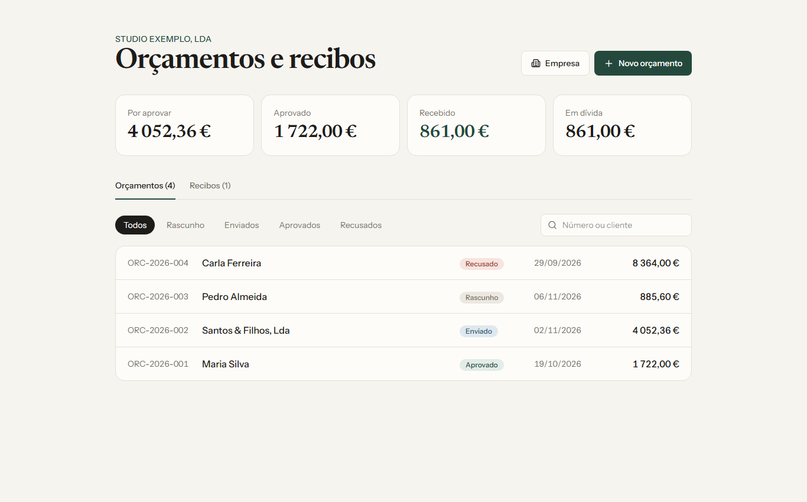

# Orçamentos e Recibos

Aplicação web para criar orçamentos, acompanhar a aprovação e emitir recibos de pagamento,
com exportação para PDF. Projeto 2 de uma série de 6 ferramentas para pequenos negócios.



## Funcionalidades

- Orçamentos com vários itens, desconto e IVA, com totais calculados em tempo real
- Numeração automática por ano (`ORC-2026-001`, `RC-2026-001`)
- Fluxo de estados: rascunho, enviado, aprovado, recusado
- Recibos com pagamentos parciais: o saldo em dívida atualiza-se a cada recibo
- PDF de orçamento e de recibo, com os dados da empresa no cabeçalho
- Painel de resumo: por aprovar, aprovado, recebido e em dívida
- Pesquisa e filtro por estado

### Regras de negócio

- Só se editam orçamentos em rascunho ou enviados
- Só se emitem recibos de orçamentos aprovados
- Um recibo nunca pode exceder o valor em dívida
- Orçamentos com recibos não podem ser apagados nem recusados
- Valores calculados no servidor, em euros, arredondados ao cêntimo

## Stack

| Camada | Tecnologia |
|---|---|
| Interface | React 19, Vite, Tailwind CSS 4 |
| API | Node.js, Express 5 (REST) |
| PDF | PDFKit |
| Base de dados | PostgreSQL |

## Como correr

Requisitos: Node.js 20+ e PostgreSQL 15+.

```bash
# 1. Base de dados
createdb orcamentos_recibos
psql -d orcamentos_recibos -f server/db/schema.sql
psql -d orcamentos_recibos -f server/db/seed.sql   # dados de demonstração (opcional)

# 2. API
cd server
cp .env.example .env     # ajusta o utilizador e a palavra-passe
npm install
npm start                # http://localhost:3002

# 3. Interface (noutro terminal)
cd client
npm install
npm run dev              # http://localhost:5173
```

## API

| Método | Rota | Descrição |
|---|---|---|
| GET | `/orcamentos` | Lista com total, pago e em dívida |
| GET | `/orcamentos/:id` | Detalhe com itens, totais e recibos |
| POST | `/orcamentos` | Cria um orçamento |
| PUT | `/orcamentos/:id` | Edita (só rascunho ou enviado) |
| PATCH | `/orcamentos/:id/estado` | Muda o estado |
| DELETE | `/orcamentos/:id` | Apaga (se não tiver recibos) |
| GET | `/orcamentos/:id/pdf` | PDF do orçamento |
| POST | `/orcamentos/:id/recibos` | Emite um recibo |
| GET | `/recibos` | Lista de recibos |
| GET | `/recibos/:id/pdf` | PDF do recibo |
| GET | `/resumo` | Indicadores do painel |
| GET, PUT | `/empresa` | Dados da empresa emitente |

## Estrutura

```
orcamentos-recibos/
  client/   interface React
  server/   API Express, geração de PDF e esquema SQL
```
